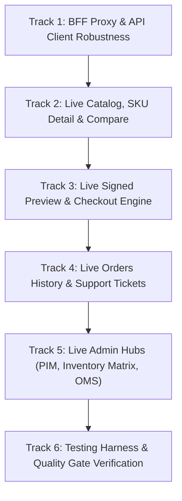

# Kế Hoạch Chuyển Đổi Web Client Sang Cơ Sở Dữ Liệu Thật
## (Web Client Live Database & Core API Integration Plan)

> **Tài liệu**: `web-client/docs/WEB_CLIENT_DATABASE_INTEGRATION_PLAN.md`  
> **Phiên bản**: Enterprise Production 1.0 (2026 Edition)  
> **Căn cứ kỹ thuật**: [`AGENTS.md`](../../AGENTS.md), [`17-FRONTEND_DESIGN.md`](../../enterprise-docs/docs/06-frontend/17-FRONTEND_DESIGN.md), và Chuẩn mực Phase-Gate DoD từ dự án tham chiếu PHP ThiSmart.  
> **Mục tiêu**: **Loại bỏ 100% Mock/In-Memory Data trong `web-client`**, kết nối trực tiếp toàn bộ giao diện với NestJS Core API (`http://localhost:4000/api/v1`) và cơ sở dữ liệu PostgreSQL 16+ thật.

---

## 🎯 1. TÔN CHỈ KỸ THUẬT & QUY TẮC CỐT LÕI (PRIME DIRECTIVES)

1. **PostgreSQL là Chân Lý Duy Nhất (Single Source of Truth - SSOT):**
   - Tuyệt đối không lưu trữ hoặc tính toán dữ liệu kinh doanh (giá niêm yết, tồn kho khả dụng, tính thuế VAT, chiết khấu voucher) cục bộ trên trình duyệt.
   - Mọi số liệu hiển thị trên Client phải được lấy từ PostgreSQL thông qua NestJS Core API.
2. **Không Giả Lập Token & Giao Dịch Cục Bộ (Zero Client-Side Token Forgery):**
   - Loại bỏ hoàn toàn logic tự sinh mã `previewToken` (`prv-${Date.now()}...`) và tự tính tiền trên frontend.
   - Bắt buộc gọi `POST /orders/preview` để nhận Signed Preview Token (HMAC-SHA256, TTL 10 phút) do Backend cấp quyền và ký bảo mật.
3. **Bảo Vệ Biên Giới Bảo Mật BFF Proxy (ADR-009):**
   - Toàn bộ giao tiếp giữa Client và Backend đi qua Next.js Route Handler `/api/proxy/[...path]`.
   - Token JWT được bảo vệ trong HttpOnly Cookie (`access_token`, `refresh_token`), không lưu trong `localStorage`. Proxy tự động giải nén cookie và đính kèm `Authorization: Bearer <token>` vào request gửi tới Core API.
4. **Định Dạng Tiền Tệ & Xử Lý Số Học Chính Xác:**
   - Số tiền hiển thị dạng chuỗi hoặc `BigInt`/`Decimal`. Nghiêm cấm dùng `float` trong tính toán giá/tổng tiền để tránh sai số IEEE-754.
5. **Kỷ Luật Phase-Gate & Kiểm Thử Lũy Tiến:**
   - Triển khai theo 6 Giai đoạn (Tracks). Mỗi Track chỉ được coi là hoàn thành (`DONE`) khi mã nguồn chạy thật với Core API/PostgreSQL và vượt qua kiểm thử tự động.

---

## 📊 2. BẢNG KIỂM KÊ NỢ KỸ THUẬT & MA TRẬN ÁNH XẠ API THẬT

| STT | Phân hệ / Màn hình | Tệp nguồn (`src/`) | Hiện trạng Mock / Hardcode | Endpoint Core API Thật (`/api/v1/...`) | Trạng thái |
| :---: | :--- | :--- | :--- | :--- | :---: |
| **01** | **BFF & Fetcher** | `lib/api-client.ts`<br>`api/proxy/[...path]/route.ts` | Lỗi bóc vỏ kép `.data?.data`. Chưa chuyển tiếp `Set-Cookie` khi đăng nhập. | Tất cả endpoints Core API | `PENDING` |
| **02** | **Đăng Nhập / Đăng Ký** | `app/login/page.tsx`<br>`app/register/page.tsx`<br>`components/workspace/TopBar.tsx` | Chuyển role tĩnh bằng cookie `retailmind_role`. Không đồng bộ `/auth/me`. | `POST /auth/login`<br>`POST /auth/register`<br>`GET /auth/me` | `PENDING` |
| **03** | **Danh Mục Sản Phẩm** | `app/catalog/page.tsx`<br>`features/catalog/services/catalog.get.ts` | Filter mảng tĩnh `BASELINE_LAPTOP_CATALOG` (10 máy). Không gọi API. | `GET /catalog/products` (Params: `search`, `brand`, `minRam`, `maxPrice`) | `PENDING` |
| **04** | **Chi Tiết Laptop & Tồn Kho** | `app/products/[sku]/page.tsx` | Luôn fallback về Asus Vivobook trong RAM. Tồn kho chi nhánh là số ảo. | `GET /catalog/products/:sku`<br>`GET /inventory/stock` | `PENDING` |
| **05** | **So Sánh Đối Đầu (4 máy)** | `app/compare/page.tsx`<br>`features/catalog/services/compare.action.ts` | Đọc spec từ mảng tĩnh trong RAM. | `GET /catalog/compare?skus=SKU1,SKU2` | `PENDING` |
| **06** | **Giỏ Hàng & Preview Token** | `app/cart/page.tsx`<br>`features/checkout/services/preview-token.get.ts` | Tự tính tiền VAT/Voucher và tự sinh fake token `prv-...` trên browser. | `POST /orders/preview`<br>`GET /cart`, `POST /cart/items` | `PENDING` |
| **07** | **Chốt Đơn (Anti-Oversell)** | `app/checkout/page.tsx`<br>`features/checkout/services/order.action.ts` | Gãy kết nối do lỗi `.data?.data`. Tên chi nhánh hardcode tĩnh. | `GET /inventory/stores`<br>`POST /orders/checkout` (Kèm `Idempotency-Key`) | `PENDING` |
| **08** | **Lịch Sử Đơn & Hủy Đơn** | `app/orders/page.tsx` | 2 đơn hardcode tĩnh. Nút hủy đơn chỉ đổi state React trong bộ nhớ tạm. | `GET /orders`<br>`GET /orders/:id`<br>`POST /orders/:id/cancel` | `PENDING` |
| **09** | **Phiếu Hỗ Trợ (Support)** | `app/support/page.tsx` | Gửi dữ liệu nhưng chưa xử lý hiển thị danh sách ticket từ DB. | `POST /support/tickets`<br>`GET /support/tickets` | `PENDING` |
| **10** | **Quản Trị PIM (Products)** | `app/admin/products/page.tsx` | Load và thêm sản phẩm vào RAM state, F5 là mất. | `GET /catalog/products`<br>`POST /catalog/products` | `PENDING` |
| **11** | **Ma Trận Tồn Kho Chi Nhánh** | `app/admin/inventory/page.tsx`<br>`features/admin-inventory/services/*` | `INITIAL_BRANCH_INVENTORY` tĩnh. Điều chỉnh kho sinh fake sha256 trong RAM. | `GET /inventory/stock`<br>`POST /inventory/adjust` | `PENDING` |
| **12** | **Quản Trị Đơn Hàng (OMS)** | `app/admin/orders/page.tsx` | 3 đơn tĩnh trong RAM. Chuyển trạng thái chỉ đổi state cục bộ. | `GET /admin/orders`<br>`GET /admin/orders/:id` | `PENDING` |
| **13** | **Sổ Cái Kiểm Toán (Audit)** | `app/admin/audit-logs/page.tsx` | Còn mảng fallback baseline events tĩnh nếu API trả về mảng rỗng. | `GET /audit` (Xác thực chuỗi SHA-256 Hash Chain) | `PENDING` |

---

## 🛠️ 3. CHI TIẾT 6 GIAI ĐOẠN THỰC THI (IMPLEMENTATION TRACKS)



---

### TRACK 1: HOÀN THIỆN HẠ TẦNG BFF PROXY & CHUẨN HÓA API CLIENT
* **Mục tiêu**: Xóa bỏ hoàn toàn lỗi bóc vỏ dữ liệu kép, hỗ trợ chuyển tiếp `Set-Cookie` khi đăng nhập/đăng ký, và cung cấp hook lấy thông tin người dùng thực từ `/auth/me`.
* **Nhiệm vụ cụ thể**:
  1. **Nâng cấp `src/lib/api-client.ts`**:
     - Chuẩn hóa hàm unwrap: Nếu response từ backend có cấu trúc `{ data: ... }` thì unwrap an toàn; nếu đã là mảng/đối tượng trực tiếp thì giữ nguyên. Không bao giờ để client nhận về `undefined`.
     - Chuyển tiếp đầy đủ `x-trace-id`, `Idempotency-Key`, `Content-Type`.
  2. **Nâng cấp Next.js BFF Proxy (`src/app/api/proxy/[...path]/route.ts`)**:
     - Sử dụng `response.headers.getSetCookie()` để chuyển tiếp các cookie HttpOnly (`access_token`, `refresh_token`) từ NestJS Core API về trình duyệt khách hàng.
     - Đảm bảo các route `/auth/login`, `/auth/register`, `/auth/refresh`, `/auth/logout` được xử lý cookie chuẩn xác.
  3. **Đồng bộ trạng thái Auth toàn ứng dụng**:
     - Cập nhật [`src/app/login/page.tsx`](file:///c:/Users/Admin/Desktop/ExcelMCP/MWG_AI_Engineer_Interview_Study_Kit/RetailMind_AI/web-client/src/app/login/page.tsx) và [`src/app/register/page.tsx`](file:///c:/Users/Admin/Desktop/ExcelMCP/MWG_AI_Engineer_Interview_Study_Kit/RetailMind_AI/web-client/src/app/register/page.tsx) kết nối trực tiếp vào `/api/proxy/auth/login` và `/api/proxy/auth/register`.
     - Xây dựng hook `useCurrentUser()` gọi `GET /api/proxy/auth/me` để hiển thị tên, email, vai trò thật trên [`TopBar.tsx`](file:///c:/Users/Admin/Desktop/ExcelMCP/MWG_AI_Engineer_Interview_Study_Kit/RetailMind_AI/web-client/src/components/workspace/TopBar.tsx).
* **Tiêu chí nghiệm thu (DoD)**:
  - Đăng nhập tài khoản seed `customer@mwg-retailmind.vn` hoặc `admin@mwg-retailmind.vn` thành công.
  - Cookie `access_token` được gán vào trình duyệt; `GET /api/proxy/auth/me` trả về thông tin User thật trong PostgreSQL.

---

### TRACK 2: TRUY VẤN DANH MỤC, CHI TIẾT SẢN PHẨM & SO SÁNH LIVE
* **Mục tiêu**: Thay thế toàn bộ mảng `BASELINE_LAPTOP_CATALOG` tĩnh bằng dữ liệu trực tiếp từ bảng `products`, `variants`, `product_specs`, `inventory`.
* **Nhiệm vụ cụ thể**:
  1. **Tái cấu trúc `src/features/catalog/services/catalog.get.ts`**:
     - Xóa bỏ việc fallback về mảng tĩnh khi API trả về rỗng.
     - Hàm `getLaptopCatalog(params)` gọi `GET /catalog/products` kèm các tham số: `search`, `brand`, `minRam`, `maxPrice`.
     - Hàm `getLaptopBySku(sku)` gọi `GET /catalog/products/${sku}`.
     - Hàm so sánh gọi `GET /catalog/compare?skus=${skuList.join(',')}`.
     - Thêm adapter chuyển đổi dữ liệu từ entity database (gồm `specs`, `priceVnd`, `variants`) sang định dạng hiển thị cho giao diện UI.
  2. **Cập nhật Màn hình Catalog (`src/app/catalog/page.tsx`)**:
     - Gọi `getLaptopCatalog` trong `useEffect` (hoặc SSR fetch) để tải danh sách máy thật.
     - Bộ lọc thương hiệu (ASUS, DELL, LENOVO, ACER, APPLE) và bộ lọc RAM/Giá lọc trực tiếp qua API query.
  3. **Cập nhật Màn hình Chi Tiết Sản Phẩm (`src/app/products/[sku]/page.tsx`)**:
     - Gọi `getLaptopBySku` với SKU từ URL. Nếu không tìm thấy, hiển thị màn hình `ScreenEmpty` hoặc `not-found`.
     - Danh sách chi nhánh và số lượng tồn kho khả dụng lấy trực tiếp từ database thật (`availableQty = onHandQty - reservedQty`).
  4. **Cập nhật Màn hình So Sánh (`src/app/compare/page.tsx`)**:
     - Tải thông số đối đầu thật của 2-4 sản phẩm trực tiếp từ API `/catalog/compare`.
* **Tiêu chí nghiệm thu (DoD)**:
  - Trang `/catalog` hiển thị danh sách sản phẩm khớp 100% với dữ liệu seed trong PostgreSQL.
  - Tồn kho từng chi nhánh tại trang `/products/[sku]` khớp với bảng `inventory` trong database.

---

### TRACK 3: ĐỒNG BỘ GIỎ HÀNG, SIGNED PREVIEW TOKEN & CHECKOUT CHỐNG OVERSELL
* **Mục tiêu**: Xóa bỏ hoàn toàn việc tính tiền và sinh token giả trên browser; chốt đơn thật có khóa bi quan và bảo vệ Idempotency.
* **Nhiệm vụ cụ thể**:
  1. **Tái cấu trúc `src/features/checkout/services/preview-token.get.ts`**:
     - Xóa bỏ hàm `calculateExactOrderPreview` tự sinh token giả `prv-...` và bảng mã voucher tĩnh trong RAM.
     - Tạo hàm gọi API thật:
       ```typescript
       export async function fetchLiveOrderPreview(payload: {
         storeId: string;
         items: { sku: string; quantity: number }[];
         discountCode?: string;
       }): Promise<OrderPreviewResponse>
       ```
       gửi yêu cầu đến `POST /api/proxy/orders/preview`. Nhận về token được ký bảo mật từ Core API.
  2. **Cập nhật Trang Giỏ Hàng (`src/app/cart/page.tsx`)**:
     - Lưu trữ giỏ hàng trong LocalStorage/Session của khách hàng và đồng bộ với endpoint `POST /cart/items` khi đã đăng nhập.
     - Khi thay đổi số lượng hoặc áp dụng mã giảm giá (`MWG_VIP500`, `BACK2SCHOOL`), gọi `fetchLiveOrderPreview` để cập nhật bảng tính tiền chính xác từ server.
  3. **Sửa Lỗi & Tối Ưu Hóa Trang Checkout (`src/app/checkout/page.tsx`)**:
     - Sửa triệt để lỗi unwrap `.data?.data` khi nạp sản phẩm và danh sách siêu thị (`/inventory/stores`).
     - Tự động sinh `Idempotency-Key: UUIDv4` cho mỗi phiên chốt đơn.
     - Gửi `previewToken`, `storeId`, `items`, `paymentMethod` lên `POST /api/proxy/orders/checkout`.
     - Hiển thị Modal Quét mã QR Napas 24/7 mô phỏng và hỗ trợ xác nhận thanh toán qua `POST /orders/:id/simulate-payment`.
* **Tiêu chí nghiệm thu (DoD)**:
  - Khách hàng bấm chốt đơn nhận được mã đơn hàng thật (ví dụ: `MWG-2026...`) lưu trong bảng `orders` của PostgreSQL.
  - Số lượng tồn kho khả dụng (`reserved_quantity`) của chi nhánh lập tức được cập nhật trong database.
  - Request trùng `Idempotency-Key` được chặn hoặc trả về biên nhận gốc mà không trừ kho lần 2.

---

### TRACK 4: QUẢN LÝ ĐƠN HÀNG CÁ NHÂN, HỦY ĐƠN HOÀN KHO & PHIẾU HỖ TRỢ
* **Mục tiêu**: Hiển thị đơn hàng thật của khách hàng, kích hoạt tính năng hủy đơn hoàn kho ACID và nộp phiếu hỗ trợ kỹ thuật vào DB.
* **Nhiệm vụ cụ thể**:
  1. **Cập nhật Trang Đơn Hàng (`src/app/orders/page.tsx`)**:
     - Xóa bỏ mảng 2 đơn hàng hardcode trong RAM.
     - Gọi `GET /api/proxy/orders` để tải danh sách đơn hàng thuộc sở hữu của Customer đang đăng nhập.
     - Hiển thị đầy đủ: Mã đơn, sản phẩm, chi nhánh nhận hàng, trạng thái (`PLACED`, `CONFIRMED`, `COMPLETED`, `CANCELLED`), hạn bảo hành, hạn đổi trả.
  2. **Triển khai Hủy Đơn Hoàn Kho Thực Tế**:
     - Nút "Hủy đơn hàng" gọi `POST /api/proxy/orders/:id/cancel`.
     - Core API thực thi giải phóng tồn kho (`reserved_quantity -= qty`), hoàn tất quy trình ACID.
     - Giao diện cập nhật trạng thái đơn thành `CANCELLED` ngay lập tức.
  3. **Kết nối Trang Phiếu Khiếu Nại / Hỗ Trợ (`src/app/support/page.tsx`)**:
     - Gửi yêu cầu hỗ trợ tới `POST /api/proxy/support/tickets`.
     - Hiển thị danh sách các phiếu hỗ trợ đã tạo từ `GET /api/proxy/support/tickets`.
* **Tiêu chí nghiệm thu (DoD)**:
  - Đơn hàng vừa tạo ở Track 3 hiển thị ngay trong danh sách đơn hàng tại `/orders`.
  - Hủy đơn thành công: Cột `status` trong bảng `orders` đổi thành `cancelled`, số lượng tồn kho khả dụng trong DB phục hồi về mức ban đầu.

---

### TRACK 5: LIVE HÓA CÁC PHÂN HỆ QUẢN TRỊ (ADMIN PIM, OMS & INVENTORY)
* **Mục tiêu**: Kết nối toàn bộ các công cụ vận hành Admin với Core API và PostgreSQL thật.
* **Nhiệm vụ cụ thể**:
  1. **Quản Lý Sản Phẩm PIM (`src/app/admin/products/page.tsx`)**:
     - Tải danh mục laptop từ `GET /api/proxy/catalog/products`.
     - Thao tác thêm sản phẩm mới gửi dữ liệu lên Core API để insert vào bảng `products` và `variants`.
  2. **Ma Trận Tồn Kho Chi Nhánh (`src/app/admin/inventory/page.tsx`)**:
     - Xóa bỏ `INITIAL_BRANCH_INVENTORY` tĩnh.
     - Tải danh sách tồn kho từ `GET /api/proxy/inventory/stock`.
     - Thao tác điều chỉnh tồn kho (nhập kho, xuất kho) gọi `POST /api/proxy/inventory/adjust`. Core API lưu biến động kho và sinh bản ghi kiểm toán Hash Chain thật.
  3. **Điều Phối Đơn Hàng OMS Hub (`src/app/admin/orders/page.tsx`)**:
     - Tải toàn bộ đơn hàng của toàn sàn từ `GET /api/proxy/admin/orders`.
     - Cho phép quản trị viên xem chi tiết đơn, chuyển bước trạng thái đơn từ `PLACED` $\rightarrow$ `CONFIRMED` $\rightarrow$ `SHIPPING` $\rightarrow$ `COMPLETED`.
  4. **Bảng Điều Khiển Tổng Quan (`src/app/admin/dashboard/page.tsx`)**:
     - Tính toán các chỉ số KPI doanh thu và số lượng đơn hàng dựa trên dữ liệu tổng hợp thực từ Core API thay vì 4 thẻ số liệu tĩnh.
  5. **Sổ Cái Kiểm Toán (`src/app/admin/audit-logs/page.tsx`)**:
     - Loại bỏ mảng fallback sự kiện tĩnh.
     - Lấy 100% bản ghi từ `GET /api/proxy/audit` và xác thực liên kết mật mã SHA-256 (`prev_hash` $\rightarrow$ `hash`).
* **Tiêu chí nghiệm thu (DoD)**:
  - Thao tác điều chỉnh kho của Admin làm thay đổi trực tiếp số lượng trong bảng `inventory` của PostgreSQL.
  - Sổ cái kiểm toán hiển thị đúng nhật ký thao tác kèm chữ ký băm SHA-256 không thể giả mạo.

---

### TRACK 6: THIẾT LẬP HARNESS KIỂM THỬ TỰ ĐỘNG & BẢO VỆ CHẤT LƯỢNG
* **Mục tiêu**: Xóa bỏ khoảng trống "0 automated tests" trong `web-client`, thiết lập bộ test hồi quy tự động tương đương tiêu chuẩn của dự án PHP.
* **Nhiệm vụ cụ thể**:
  1. **Cấu hình Môi Trường Test**:
     - Cài đặt Jest, `@testing-library/react`, `@testing-library/jest-dom`, và `msw` (để mock network trong unit test).
     - Tạo file cấu hình `jest.config.js` và `jest.setup.ts` chuẩn cho Next.js App Router.
  2. **Xây Dựng Bộ Test Suites Trọng Yếu**:
     - `src/lib/api-client.spec.ts`: Kiểm thử unwrap dữ liệu, xử lý retry (502/503), và đính kèm trace headers.
     - `src/features/checkout/order-action.spec.ts`: Kiểm thử gửi `Idempotency-Key` và xử lý biên nhận đơn hàng.
     - `src/features/catalog/catalog.spec.ts`: Kiểm thử parse và chuyển đổi dữ liệu sản phẩm.
     - `src/components/CurrencyText.spec.ts`: Kiểm thử định dạng tiền tệ VNĐ không dùng float.
  3. **Kiểm Tra Build & Lint**:
     - Chạy `npm run build` xác nhận 30 routes biên dịch sạch sẽ.
     - Chạy `npm test` xác nhận 100% test suites vượt qua.
* **Tiêu chí nghiệm thu (DoD)**:
  - Tối thiểu 4 test suites tự động hoạt động ổn định và vượt qua mọi bài test.

---

## 📈 4. THỨ TỰ THỰC THI & LỘ TRÌNH TỪNG BƯỚC (STEP-BY-STEP WORKFLOW)

```text
[BƯỚC 1] ──> Sửa api-client.ts & proxy/route.ts (Xóa lỗi .data?.data, hỗ trợ Set-Cookie)
    │
[BƯỚC 2] ──> Kết nối Đăng nhập/Đăng ký vào Core API Auth & Hiển thị thông tin User thật
    │
[BƯỚC 3] ──> Chuyển đổi Catalog & Product Detail sang chế độ Live (Xóa BASELINE_LAPTOP_CATALOG)
    │
[BƯỚC 4] ──> Thay thế Preview Token giả bằng Core API /orders/preview
    │
[BƯỚC 5] ──> Live hóa Checkout chốt đơn có Idempotency & Quản lý đơn hàng cá nhân /orders
    │
[BƯỚC 6] ──> Live hóa các màn hình Admin (PIM, Tồn kho chi nhánh, OMS Đơn hàng, Audit Logs)
    │
[BƯỚC 7] ──> Thiết lập Jest Test Harness, chạy kiểm thử và nghiệm thu toàn diện hệ thống
```

---

## ✅ 5. ĐỊNH NGHĨA HOÀN THÀNH TOÀN BỘ (DEFINITION OF DONE - DOD)

1. **Không còn bất kỳ dữ liệu mẫu hardcode nào** trong các luồng người dùng chính: Xem sản phẩm, đặt hàng, xem lịch sử đơn, điều chỉnh tồn kho, kiểm toán.
2. **PostgreSQL là nguồn chân lý duy nhất**: Mọi thay đổi trên màn hình (đặt hàng, đổi trạng thái đơn, sửa kho) đều được lưu trữ bền vững trong cơ sở dữ liệu thật. F5 trang dữ liệu không bị biến mất.
3. **Biên dịch `npm run build` đạt 100% thành công**, không có lỗi TypeScript, không có cảnh báo kiểu dữ liệu.
4. **Bộ test tự động của `web-client` đạt kết quả PASS 100%**.
5. **Mã nguồn được commit sạch sẽ** và đồng bộ lên kho lưu trữ GitHub theo đúng quy chuẩn `commit-standards`.

